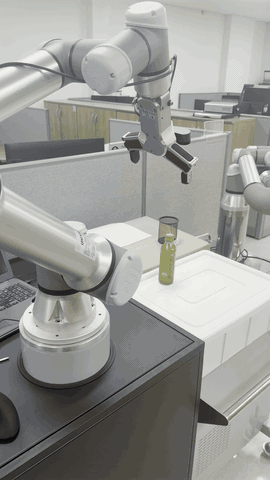
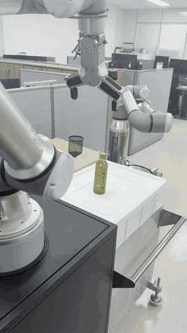
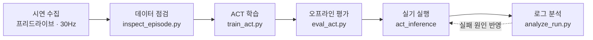

# UR5e ACT 모방학습 Pick & Place

실제 UR5e 협동로봇에서 프리드라이브로 시연 50개를 모으고, ACT(Action Chunking with Transformers) 구조를 PyTorch로 구현해 처음부터 학습한 pick & place 프로젝트입니다. 최종 버전은 실기에서 **20회 중 15회(75%)** pick & place에 성공했습니다.

<p align="center">
  
  &nbsp;&nbsp;
  
</p>
<p align="center">
  <sub>왼쪽: pick & place (2배속) · 오른쪽: 다가가는 중에 병을 옮겨도 매 추론마다 카메라 영상을 다시 보고 바뀐 위치로 따라가 잡음 (2배속)</sub>
</p>

- 이미지 백본(ResNet18)만 ImageNet 사전학습 가중치를 쓰고, 나머지는 직접 모은 시연으로 처음부터 학습했습니다. 미리 학습된 ACT 가중치, LeRobot, MoveIt은 쓰지 않았습니다.
- 코드는 Claude를 활용해 작성했고, 시연 수집·실기 테스트·실행 로그 기반 실패 원인 분석은 직접 진행했습니다.

## 왜 모방학습인가

이 프로젝트는 [Isaac Sim pick & place 시뮬레이션 프로젝트](https://github.com/Daehwan0410/Isaacsim_pick_place)(Panda + RealSense D455)의 후속입니다. 같은 방식(물체 인식 → 좌표 계산 → MoveIt 경로)을 실물 UR5e로 옮기자 MoveIt 경로가 손목을 과도하게 회전시키는 문제가 있어, 좌표를 계산해 움직이는 대신 **사람의 시연을 그대로 따라 하는 모방학습**으로 방향을 바꿨습니다.

## 결과 요약

| 항목 | 값 |
| --- | --- |
| **실기 성공률 (최종 버전)** | **20회 중 15회 성공 (75%)** |
| 실기 성공률 (초기 버전) | 7회 중 2회 성공 |
| 시연 데이터 | 50 에피소드 (학습 45 / 검증 5), 에피소드당 약 28초, 30Hz |
| 학습 | RTX 3050 Ti Laptop 4GB, 30,000 스텝, 약 2시간 20분 |
| 최저 검증 L1 | 0.1443 (26,000 스텝) |
| 오프라인 평가 (검증 5개) | 관절별 평균 오차 0.7–3.7°, 그리퍼 열림/닫힘 일치율 92–99% |
| 실기 추론 | GPU 없는 Ubuntu 노트북 CPU, 예측 1회 약 275ms |

오프라인 평가 수치는 시연을 얼마나 따라 하는지를 보여 주며, 실기 성공률과는 다른 지표입니다.

### 초기 버전 → 최종 버전 개선 과정

초기 버전 7회의 실패 원인을 아래처럼 분류하고, 원인별로 고친 결과가 최종 버전입니다.

| 결과 | 횟수 | 원인 → 최종 버전에서의 조치 |
| --- | --- | --- |
| 성공 | 2 | 잡기·옮기기·놓기 완료 |
| 실패: 그리퍼 안 닫힘 | 2 | 물체 앞까지 가지만 닫기로 넘어가지 못함 → temporal ensembling + 그리퍼 히스테리시스 |
| 실패: 안전 정지 | 2 | 추론 지연을 고려하지 않은 정렬로 예측 시작점이 12.5°·11.8° 어긋남 → 위치 정렬 앙상블 |
| 실패: 잡기 위치 어긋남 | 1 | 트레이 가장자리의 물체, 비슷한 시연 3–4개뿐이고 복구 시연 없음 → 남은 과제 |

## 하드웨어

| 구성 | 내용 |
| --- | --- |
| 로봇 | Universal Robots UR5e (URControl 5.12.4) |
| 그리퍼 | OnRobot RG6, UR Tool 디지털 출력(pin 16)으로 열기/닫기 |
| 카메라 | Logitech BRIO 1대 (팔에 장착, depth 없음), 320×240으로 저장 |
| 로봇 PC | Ubuntu 22.04, ROS 2 Humble, GPU 없음 — 수집·추론 |
| 학습 PC | Windows, RTX 3050 Ti Laptop 4GB, conda — 학습·평가 |
| 연결 | 유선 LAN, External Control URCap |

## 전체 흐름



1. **수집** (Ubuntu, `data_collector`): 프리드라이브로 손으로 시연 → ACT 형식 HDF5 저장
2. **점검** (`inspect_episode.py`): fps 저하·그리퍼 중복 토글·과도한 회전 확인, mp4 미리보기 생성
3. **학습** (Windows, `train_act.py`): ACT 학습, 검증 손실이 가장 낮은 `policy_best.ckpt` 저장
4. **평가** (`eval_act.py`): 검증 에피소드에서 시연과 모델 예측을 비교하는 그래프
5. **실행** (Ubuntu, `act_inference`): 모델로 잡기 → 고정 경로로 옮겨 놓기 → 관찰 자세 복귀
6. **분석** (`analyze_run.py`): 실행 로그로 머뭇거림·그리퍼 예측·100Hz 관절 가속도 확인

> 잡기까지는 ACT 정책이 수행하고, 놓기는 시연마다 위치가 조금씩 달라 흔들림이 생겨 **고정 경로**로 실행합니다.

## 모델

| 구분 | 내용 |
| --- | --- |
| 입력 | 관절 6개(rad) + 그리퍼 상태 = 7차원, RGB 이미지 1장 |
| 출력 | 100×7 action chunk — 30Hz 기준 약 3.3초 분량의 목표 관절값 + 그리퍼 |
| 이미지 인코더 | ResNet18 (ImageNet 사전학습, FrozenBatchNorm2d) + 2D 사인 위치 임베딩 |
| Transformer | 인코더 4층, 디코더 1층, hidden 512, head 8, FFN 3200, dropout 0.1 |
| CVAE | 인코더 4층, 잠재변수 32차원 |
| 파라미터 수 | 51.6M |
| 손실 | L1 + KL (가중치 10) |
| 학습 설정 | batch 16, lr 1e-5 (AdamW), AMP, GPU 이미지 증강 |

주요 설정은 원 논문 구현의 설정을 따랐습니다.

## 실기 실행에서 해결한 문제

| 문제 | 원인 | 해결 |
| --- | --- | --- |
| 그리퍼가 닫히지 않음 | 매 추론의 action chunk를 따로 실행해 닫기 예측이 끊김 | temporal ensembling (exp(−0.01·i)) + 그리퍼 히스테리시스 (닫기 0.5 / 열기 0.4, 최소 1초 유지) |
| 시작 직후 안전 정지 | 추론 약 275ms 동안 로봇이 이미 움직여, 시간 기준 정렬이 실제 위치와 어긋남 | 현재 위치에 가장 가까운 점에 맞춰 chunk를 합치는 위치 정렬 앙상블 |
| 속도를 올리면 크게 흔들림 | 새 chunk로 바뀔 때 목표와 속도가 불연속 | 10스텝 크로스페이드, 3차 곡선(C1 연속) 맞춤, 첫 스텝 속도 제한 |
| 0.3초마다 "툭툭" 소리 | ROS 2 Humble 궤적 컨트롤러가 새 궤적을 받을 때마다 시작점을 측정 위치로 다시 잡아 목표가 뒤로 끌려옴 (`open_loop_control: true`는 드라이버 오류) | `forward_position_controller`로 200Hz 위치 스트리밍, 스텝당 속도 제한, 추종 오차 5° 초과 시 정지, 3차 곡선으로 정지 |
| 놓기 위치가 매번 다르고 옮길 때 흔들림 | 시연마다 놓는 위치가 조금씩 다름 | 잡은 뒤는 고정 경로: 수직 들기 → 베지어 곡선 이동 → 수직 하강 → 열기 → 관찰 자세 (최소 저크, 자세 유지 IK) |
| 중간에 머뭇거림 | 학습 데이터에 없는 상황 | 머뭇거림 감지(8초간 4° 미만 이동 시 정지) + 실행 로그 저장·분석 |

## 폴더 구성

```
pick_place/              ROS 2 패키지 (ament_python)
  pick_place/
    data_collector.py    시연 수집 노드 (프리드라이브, 키보드 조작)
    act_inference.py     학습된 모델로 실기 실행 노드
    act_model.py         ACT 모델 (PyTorch) + 추론용 ACTPolicy
    ur_kin.py            UR5e 정기구학/수치 역기구학 (numpy)
training/                학습 PC에서 실행 (ROS 불필요)
  train_act.py           학습
  eval_act.py            오프라인 평가·시각화
  analyze_run.py         실기 실행 로그 분석
  inspect_episode.py     수집 데이터 점검
config/
  place_pose.json        놓기 자세 (시연 데이터에서 추출)
docs/                    README용 GIF
```

시연 데이터(약 2.5GB)와 체크포인트는 용량 때문에 저장소에 포함하지 않았습니다.

## 실행 방법

### 1. 로봇 PC (Ubuntu 22.04 + ROS 2 Humble)

```bash
pip install -r requirements-robot.txt
cd ~/ros2_ws/src && git clone <이 저장소> && cd ~/ros2_ws
colcon build --symlink-install --packages-select pick_place
source install/setup.bash
```

터미널 3개를 띄웁니다.

```bash
# 1) UR 드라이버 (드라이버 실행 후 티치 펜던트에서 External Control 프로그램 실행)
ros2 launch ur_robot_driver ur_control.launch.py ur_type:=ur5e robot_ip:=<로봇 IP>

# 2) 카메라
ros2 run usb_cam usb_cam_node_exe --ros-args -p video_device:=/dev/video0

# 3-a) 시연 수집
ros2 run pick_place data_collector
# 3-b) 학습된 모델 실행
ros2 run pick_place act_inference --ros-args -p ckpt:=$HOME/act_data/policy_best.ckpt
```

**수집 키**

| 키 | 동작 |
| --- | --- |
| `o` | 관찰 자세로 이동 |
| `f` | 프리드라이브 켜기/끄기 |
| `g` | 그리퍼 열기/닫기 |
| `SPACE` | 녹화 시작/정지 |
| `d` | 현재 에피소드 버리기 |
| `p` | 현재 자세를 관찰 자세로 저장 |
| `q` | 종료 |

한 에피소드: `o` → 물체를 새 위치에 놓기 → `f` → `SPACE` → 손으로 시연(`g`로 집고 놓기) → 손 떼고 `o` (복귀 후 자동 저장)

**실행 키**: `o` 관찰 자세, `SPACE` 실행 시작/정지, `q` 종료. `config/place_pose.json`을 `~/act_data/pick_place/`에 복사해 두면 놓기 자세로 사용합니다.

### 2. 학습 PC (Windows + conda)

```bash
pip install -r requirements-train.txt
python training/inspect_episode.py C:\act_data\pick_place
python training/train_act.py --data_dir C:\act_data\pick_place --out_dir C:\act_runs\run1 --batch 16 --workers 4 --steps 30000
python training/eval_act.py --ckpt C:\act_runs\run1\policy_best.ckpt --data_dir C:\act_data\pick_place
```

## 데이터 형식

원본 ACT와 같은 HDF5 구조입니다.

```
observations/qpos            (T, 7)  관절 6개 + 그리퍼(0=열림, 1=닫힘)
observations/qvel            (T, 7)
observations/images/cam_main (T, 240, 320, 3) uint8 RGB
action                       (T, 7)  다음 스텝의 qpos
timestamp                    (T,)
```

## 남은 과제

- 트레이 가장자리 시연 10–15개, 빗나간 뒤 다시 맞추는 복구 시연 약 10개를 추가해 재학습
- 100Hz 실기 관절 로그로 위치 스트리밍 적용 전후의 부드러움을 정량 비교
- 놓기 동작도 학습으로 수행하도록 확장

## 참고

- Zhao et al., *Learning Fine-Grained Bimanual Manipulation with Low-Cost Hardware* (ACT, 2023) — https://arxiv.org/abs/2304.13705
- 원본 구현 — https://github.com/tonyzhaozh/act
- Universal_Robots_ROS2_Driver — https://github.com/UniversalRobots/Universal_Robots_ROS2_Driver
